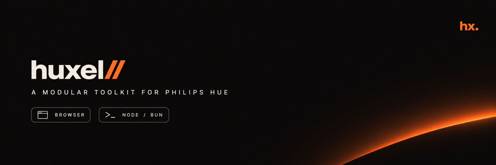

# huxel



A modular toolkit for Philips Hue. The same bridge calls and the same light state run in a browser, in Node.js, and in Bun.

Two libraries are published. The apps are private products built on them.

## Packages

### [@huxel/client](./packages/client)

[npm](https://www.npmjs.com/package/@huxel/client) · 0.2.0

One typed client for the [Hue CLIP API v2](https://developers.meethue.com/develop/hue-api-v2/).

- Send the HTTP calls and own the types, so the next app does not start from scratch.
- Mirror the official API. 10 of 46 resource types are supported, plus bridge discovery, link-button registration, and the event stream.
- Store nothing. The bridge address and the application key are passed in on each call.

### [@huxel/app](./packages/app)

[npm](https://www.npmjs.com/package/@huxel/app) · 0.1.0

Headless state for the lights, rooms, and zones in one home.

- Load them, then change power, brightness, color, and color temperature.
- Follow changes made somewhere else, such as the Hue app, a switch, or an automation.
- Hand the same state to Svelte 5 and React. Those adapters are optional.

The application key stays in memory for the life of the app. Saving it between launches belongs to the product that calls this package. `@huxel/client` does the HTTP.

### [@huxel/design-system](./packages/design-system)

Private. Svelte 5 components and design tokens shared by the web dashboard and the browser extension. It renders `@huxel/app` state and ships no UI of its own to npm.

## Apps

Each app links to a bridge, keeps the application key, and talks to the lights through `@huxel/app`.

### [svelte-app](./apps/svelte-app)

Web dashboard. List lights, rooms, and zones, then toggle, dim, and set color with live updates. Run it locally, or deploy it to a server.

### [extension](./apps/extension)

Chromium toolbar popup for Arc and Chrome. Control the lights on the local network from the browser. You load it unpacked from a local build.

### [tui-hue-app](./apps/tui-hue-app)

Terminal remote. Link a bridge, then toggle and dim lights, rooms, and zones, including the same presets as the web dashboard.

### [hue-mcp](./apps/hue-mcp)

Local MCP server for an agent on the same network. It speaks stdio and can report status, link a bridge, read the home, and set a light, a room, a zone, or a scene. The application key stays in a config file and is never returned by a tool.

## Development

Requires [Bun](https://bun.sh) and Node.js `^22.18`, `^24.11` or `>=26` (CI uses `.node-version`). Tooling comes from [Vite+](https://viteplus.dev): `vp pack` builds the libraries, `vp test` runs Vitest, and `vp fmt` formats the code.

```bash
bun install
bun run build
bun run check
bun run lint
bun run test
```

Root scripts run in every workspace in dependency order, so `@huxel/client` builds before `@huxel/app`, `@huxel/app` before `@huxel/design-system`, and all of them before the apps. Apps consume the libraries' `dist/` builds, so build the libraries before running an app. Run a script in a single workspace with `bunx vp run --filter <name> <script>`.

Formatting settings are shared across the repository in the root `vite.config.ts`: `bun run format`.
