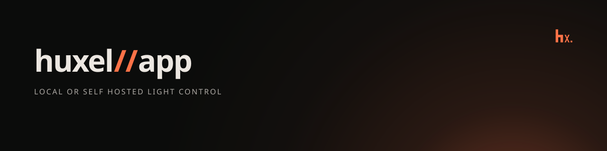

# huxel//app



Web dashboard for Philips Hue lights, rooms, and zones: link to a bridge, list them, and toggle, dim, and set their color with live updates. Built with SvelteKit on top of [`@huxel/app`](../../packages/app) and [`@huxel/client`](../../packages/client).

## Setup

`@huxel/app` and `@huxel/client` are workspace dependencies that resolve to their `dist/` builds, so build them first from the repository root:

```bash
bun install
bun run --filter @huxel/client --filter @huxel/app build
```

## Run

```bash
bun run dev
```

In development, Vite proxies `/bridge` to the bridge at `https://192.168.1.10` (see `vite.config.ts`), and the bridge id is set in `src/lib/hue/bridge.ts`. Adjust both for your bridge.

On first run, press the link button on the bridge and then connect from the page. The application key is stored in `localStorage`.

## Scripts

```bash
bun run check
bun run test
bun run lint
bun run build
```
