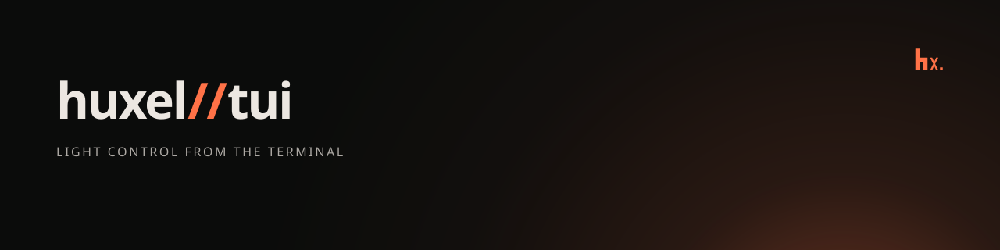

# huxel//tui



Terminal remote for Philips Hue lights, rooms, and zones: link to a bridge, then toggle and dim any of them. Rooms and zones also take the same presets and palette colors as the web remote. Built with [OpenTUI](https://opentui.com) and React on top of [`@huxel/app`](../../packages/app) and [`@huxel/client`](../../packages/client). Requires [Bun](https://bun.sh).

## Setup

`@huxel/app` and `@huxel/client` are workspace dependencies that resolve to their `dist/` builds, so build them first from the repository root:

```bash
bun install
bun run --filter @huxel/client --filter @huxel/app build
```

## Run

```bash
bun start
bun run dev
```

The bridge is resolved in this order:

1. `HUE_BRIDGE_IP` and `HUE_BRIDGE_ID` environment variables
2. The config file
3. The Hue discovery service (`https://discovery.meethue.com/`), first bridge found

```bash
HUE_BRIDGE_IP=192.168.1.10 HUE_BRIDGE_ID=001788fffe7d45eb bun start
```

On first run the app asks you to press the link button on the bridge and then Enter within 30 seconds.

## Keys

Rooms, zones, and lights are listed in that order. Rooms and zones are sorted by name. `p` and `c` open presets and colors for the selected room or zone while it is on. Color is available when that group has a color.

| Key               | Action                                  |
| ----------------- | --------------------------------------- |
| `↑` `↓` / `k` `j` | Select a room, zone, or light           |
| `space` / `enter` | Toggle the selection, or apply a choice |
| `←` `→` / `h` `l` | Dim the selection by 10%                |
| `p`               | Presets for the selected room or zone   |
| `c`               | Colors for the selected room or zone    |
| `esc`             | Close presets or colors, or quit        |
| `q` / `^C`        | Quit                                    |

## Config

Stored at `$XDG_CONFIG_HOME/hue-remote/config.json`, or `~/.config/hue-remote/config.json`, with mode `0600` because it contains the application key:

```json
{ "bridge": { "id": "001788fffe7d45eb", "ip": "192.168.1.10" }, "appKey": "…" }
```

Delete the file to link again or to forget a discovered bridge.

## TLS

Bridges serve HTTPS with a certificate whose common name is the bridge id, issued by the Signify Hue root CA (embedded in `src/bridge/hue-root-ca.ts`). The bridge HTTP client trusts only that CA and accepts the certificate only when its common name matches the bridge id, so the IP address is never trusted on its own. Certificate verification is never disabled.

Requests use `keepalive: false` because Bun skips `checkServerIdentity` on reused pooled sockets; every request opens a verified connection. Requests time out after 10 seconds so an unreachable bridge fails instead of hanging.

## Limitations

- Bridges with self-signed certificates (older firmware) are not supported and fail with a certificate error.
- No live updates: changes made by other apps are not shown until restart.
- Only the first discovered bridge is used; set the environment variables to choose another.

## Scripts

```bash
bun run check
bun test
bun run lint
bun run format
HUE_BRIDGE_IP=192.168.1.10 HUE_BRIDGE_ID=001788fffe7d45eb bun scripts/smoke-tls.ts
```
