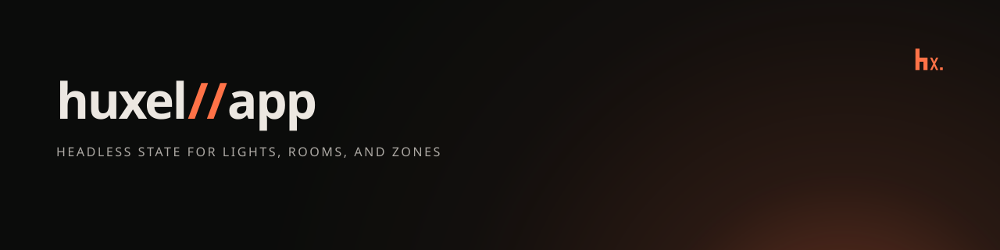

# huxel//app



Headless application state for Philips Hue lights, rooms, and zones. Built on [`@huxel/client`](https://www.npmjs.com/package/@huxel/client) and [`@preact/signals-core`](https://github.com/preactjs/signals). The same state runs in Node.js, browsers, and browser extensions. Svelte 5 and React adapters are optional.

## Install

```bash
npm install @huxel/app @huxel/client
```

```bash
bun add @huxel/app @huxel/client
```

## Goals

One place for the state of a Hue home.

- Load lights, rooms, and zones, then change power, brightness, color, and color temperature.
- Show changes made somewhere else, such as the Hue app, a switch, or an automation, while this app is open.
- Give Svelte and React that state without each app writing its own store.

`@huxel/client` sends the HTTP calls. This package remembers what the lights are doing.

## Credentials

Pass the bridge address and the application key. This package keeps both in memory for the life of the `HueApp` and sends the key only as the `hue-application-key` header. The key is not written to disk, and it is not included in errors or logs.

Saving the key between launches belongs to your application. `describeError` returns a sentence for the screen from the error message. It leaves out the key and the response body.

Finding the bridge and pressing the link button stay in `@huxel/client` (`discoverBridges`, `registerApplication`).

## Node

```ts
import { createHueApp, hexToXy } from '@huxel/app';

const app = createHueApp({ baseUrl: 'https://192.168.1.100', appKey });

await app.initialize();

const light = app.state.lights.get('light-id');
if (!light) throw new Error('Light not found');

await app.toggleLight(light.id);
await app.dimLight(light.id, 50);
if (light.color.value) await app.changeColor(light.id, hexToXy('#ff8000'));

app.dispose();
```

`createHueApp` builds its client with `throttle: false`. This package already sends one write at a time per light property. The client's default write throttling can resolve one command with another request's response.

Node's `fetch` rejects the bridge certificate. Pass `httpClient` from `@huxel/client`, the same way that package's README does, so the connection trusts the Hue root CA.

## Svelte 5

```svelte
<script lang="ts">
	import { hexToXy } from '@huxel/app';
	import type { SvelteHueApp } from '@huxel/app/svelte';

	let { hue, lightId }: { hue: SvelteHueApp; lightId: string } = $props();
	const light = $derived(hue.lights.get(lightId));
</script>

{#if light}
	<button onclick={() => hue.toggleLight(lightId)}>{light.name}</button>
	<button onclick={() => hue.changeColor(lightId, hexToXy('#ff3b30'))}>Red</button>
{/if}
```

Create the adapter once, next to the app:

```ts
import { createHueApp } from '@huxel/app';
import { createSvelteHueApp } from '@huxel/app/svelte';

const hue = createSvelteHueApp(createHueApp({ baseUrl, appKey }));
await hue.initialize();
```

`hue.lights`, `hue.rooms`, and `hue.zones` are plain reactive values. Svelte is an optional peer dependency.

## React

```tsx
import type { HueApp } from '@huxel/app';
import { useHueApp } from '@huxel/app/react';

export function Lights({ app }: { app: HueApp }) {
	const hue = useHueApp(app);

	return hue.lights.map((light) => (
		<button key={light.id} onClick={() => hue.toggleLight(light.id)}>
			{light.name}
		</button>
	));
}
```

Requires React 18 or newer. React is an optional peer dependency. Each row keeps its identity until that light changes.

## What the state does

Commands update the screen immediately, then wait for the bridge. Each light has one lane for power, one for brightness, one for color, and one for color temperature. A slider drag sends the latest value. A failed command rolls back to the last value the bridge confirmed.

Live updates are on by default. `app.state.connection` is `offline`, `connecting`, `live`, or `reconnecting`. Call `app.dispose()` when the app goes away, or pass `live: false`.

Rooms and zones come back sorted by name. `isOn` is true when any light in the group is on. Colors are CIE 1931 xy. `hexToXy` and `xyToHex` convert sRGB hex. Color temperature is mirek. `areaPresets` is Bright, Relax, and Energize.

## Non-goals

- Discovering the bridge or registering an application. That is `@huxel/client`.
- Writing the application key to disk or to the browser.
- A user interface. The Svelte and React adapters only expose state.
- Gradients, effects, scenes, and Entertainment streaming.

Release notes are in [CHANGELOG.md](./CHANGELOG.md).
