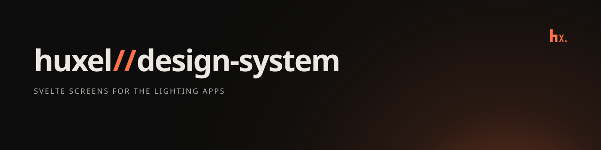

# huxel//design-system



Svelte 5 components and design tokens shared by [`svelte-app`](../../apps/svelte-app) and [`extension`](../../apps/extension). Light components render the state of [`@huxel/app`](../app)'s Svelte adapter.

## Usage

```svelte
<script lang="ts">
	import { DashboardBar, Hero, LightsSection } from '@huxel/design-system';
	import type { SvelteHueApp } from '@huxel/app/svelte';

	let { hue }: { hue: SvelteHueApp } = $props();
</script>

<DashboardBar label="Hue control dashboard" date={new Date()} connection={hue.connection} />
<Hero title="Home Lights" subtitle="Bridge" />
<LightsSection {hue} />
```

Import the shared tokens once, then these component aliases. Load Instrument Sans. Do not load Inter.

```css
@import 'tailwindcss';
@import '@fontsource-variable/instrument-sans';
@import '@huxel/tokens/tokens.css';
@import '@huxel/design-system/tokens.css';
```

Components are styled only through the custom properties in `tokens.css`, so an app adapts the layout by overriding them, for example `--page-gutter` or `--text-title` in a narrow popup.

`ConnectPanel` is presentational: pass `connecting`, `error` and `onconnect`, and render extra fields, such as a bridge address input, as its children.

## Scripts

```bash
bun run build
bun run check
bun run lint
bun run test
```

`build` runs `svelte-package` into `dist/`, which the apps consume. Component tests run in Chromium through Vitest browser mode.
