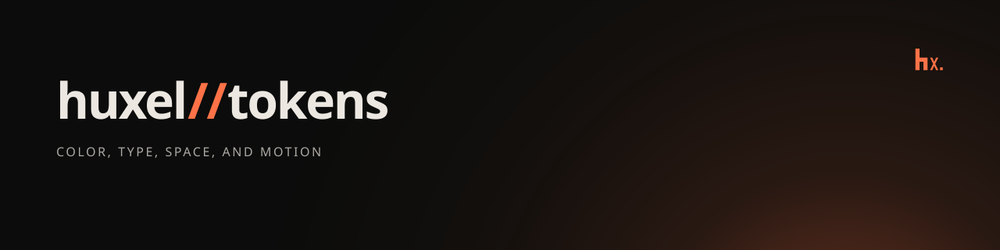

# huxel//tokens

Canonical color, type, spacing, and motion tokens for Huxel.

CSS custom properties are the only source of visual values. JavaScript reads those variables. It does not redeclare colors, durations, easings, radii, or type sizes.

## Imports

- `@huxel/tokens/tokens.css` — ramps, semantic aliases, type, scale, motion, and base rules
- `@huxel/tokens/tailwind.css` — Tailwind v4 theme mapped to those variables
- `@huxel/tokens/values` — `tokenValue(name)` and `tokenNames()`
- `@huxel/tokens/motion` — `readMotion(name)` and `readDurationMs(name)`
- `@huxel/tokens/scroll` — `scrollTo(target, { top, left })`

`tokenValue` resolves a value that is exactly `var(--token)`. `color-mix()` and other functions stay as written. Duration reads return `0ms` or `0` when the document is unavailable, the variable does not parse, or reduced motion is requested. `scrollTo` scrolls smoothly, and uses `auto` under reduced motion.

## Palette

The interface is dark and matte. Instrument Sans is the UI family. IBM Plex Mono is the code family. The brand accent is `#FF7247`. Critical, warning, success, and featured ramps are functional. Insight gold is only for the intelligent-treatment ring.
